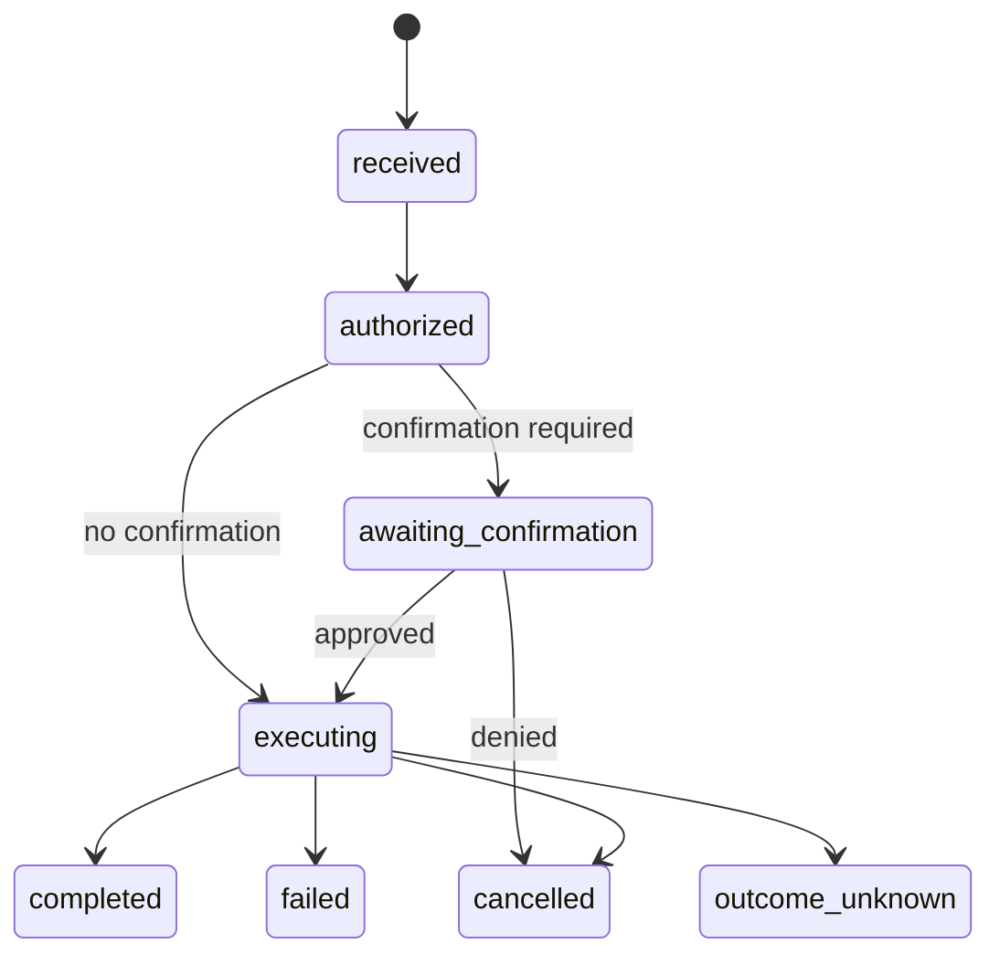

# Capability Contacts Protocol (CCP)

## Working Draft v0.5

**Status:** Exploratory working draft --- not an implementation
standard\
**Date:** 22 October 2026\
**Purpose:** Define an interoperable, user-controlled way for people,
services, and AI agents to request narrowly scoped actions from software
under the user's control.

> **Core idea:** The internet should let people grant capabilities, not
> surrender broad access to their data and accounts. A requester asks
> for a specific action; a trusted runtime checks the user's grant and
> either rejects the request, asks for confirmation, or executes an
> already-installed capability within explicit limits.

This draft develops the original CCP v0.1 concept and incorporates
lessons from a working messenger payment flow. It is intentionally
explicit about what is a protocol requirement, what is an implementation
choice, and what remains unresolved.

------------------------------------------------------------------------

## 1. Abstract

The Capability Contacts Protocol (CCP) is a proposed open protocol for
requesting actions from a user's device or another executor chosen by
the user. A person or service is represented as a contact-like
relationship. That relationship identifies the requester; it does
**not**, by itself, authorize every action.

A requester publishes a signed capability manifest describing the
operations it may request, their input schemas, required permissions,
execution placement, data egress, and suggested limits. The user
approves a specific subset of those operations in a trusted client. The
client creates a local grant that is bound to the requester's
cryptographic identity and the approved manifest version.

When a request arrives, the runtime verifies the request and checks it
against the active grant. It rejects requests that are unauthorized,
malformed, expired, replayed, or outside limits. If the grant requires
human confirmation, the runtime presents a trustworthy prompt before
executing. The runtime invokes only capabilities already installed and
exposed by the client; a request does not deliver executable code.

CCP aims to make least-authority interactions usable by non-experts and
enforceable by software. It can support people, conventional services,
and AI agents without assuming that a model's judgment is a security
boundary. It does not define a payment network, identity registry,
transport protocol, or universal trust authority.

## 2. Motivation

Many digital services ask users to hand over data, account access, or
long-lived credentials so the service can perform a relatively narrow
task. The same problem becomes more dangerous when an AI agent can act
autonomously.

Common failure patterns include:

-   **Excessive authority:** a tool receives broad account or API access
    for a narrow task.
-   **Scattered revocation:** permissions are managed across unrelated
    dashboards and providers.
-   **Unnecessary disclosure:** data leaves a device even when the
    requested computation could happen locally.
-   **Ambiguous trust:** being connected to a person or service is
    mistaken for permission to perform every operation.
-   **Agent confusion:** untrusted content or prompt injection persuades
    an agent to misuse authority it already holds.
-   **Provider-specific integrations:** every client and service must
    build bespoke permission and execution logic.

CCP proposes a common pattern: identify the requester, describe the
operation, approve the permitted authority, enforce it in a trusted
runtime, and return only the result authorized by the operation's
schema.

### 2.1 The motivating payment flow

The original use case comes from a messenger with locally controlled
wallets:

1.  A sender chooses a trustee, enters an amount such as `1 USDC`, and
    presses **Send**.
2.  The sender's app sends a request to the recipient through an
    end-to-end encrypted channel using Signal Protocol/libsignal.
3.  The recipient's app checks the recipient's local payment permission.
4.  If payments are not allowed, the recipient's app rejects the request
    and does not disclose the Ethereum address through this flow.
5.  If payments are allowed, the recipient's app may return the address
    required by the payment flow.
6.  The sender's wallet/application code then constructs and submits the
    blockchain transaction.

This demonstrates an important authorization boundary: **the recipient's
app enforces the permission before disclosing the information needed by
this payment flow**. The interface is simple, but the restriction is
enforced by the receiving application rather than merely by the sender's
interface.

It does not mean the address is secret if it is already known, nor does
it prevent someone from sending funds directly on a public blockchain
outside this app. It also does not mean libsignal itself executes
payments: the encrypted channel carries the request and response; wallet
and application code coordinate the transfer.

The flow above is the **pull** profile: a request triggers consent and a
response. A **push** profile — standing consent, then a later disclosure
or announcement — uses the same grant record but has no request at
disclosure time. The initial profile standardizes only
`payment.address.resolve` (§25.6); preparing or submitting a transfer
belongs to a separately reviewed extension. This illustration describes
the generalized pattern, not a shipped payment flow. The runnable
reference is `docs/quickstart.md`.

CCP generalizes the pattern beyond payments. A capability might search a
local folder, summarize selected email, retrieve a file, request a
payment, or operate a device. Each capability must define exactly what
it permits and what it exposes.

## 3. Design principles

1.  **Relationship is not authority.** Adding a contact identifies a
    party; it grants no capability until the user approves one.
2.  **Least authority.** A grant permits only the named intents and
    limits required for the intended task.
3.  **Local enforcement.** Authorization is checked by the consumer's
    trusted runtime, not by the requester or an AI model.
4.  **No executable requests.** A signal carries an intent and typed
    data, not code to run.
5.  **Explicit disclosure.** The user can see whether data stays local,
    is sent to a named endpoint, or is processed by a delegated
    executor.
6.  **Revocation under user control.** A user can disable a grant
    without asking the requester to cooperate.
7.  **Safe defaults.** Unknown intents, unknown required fields, invalid
    signatures, stale requests, and missing grants fail closed.
8.  **Interoperability.** The protocol's wire format and core semantics
    are independent of any one app, company, registry, or transport.
9.  **Human-usable security.** The trusted client, not the requester,
    renders permission prompts and communicates the consequences in
    plain language.
10. **Agents receive no special exemption.** An AI agent's actions are
    bounded by the same runtime-enforced grants as any other requester.

## 4. Goals and non-goals

### 4.1 Goals

CCP aims to provide:

-   Signed, versioned manifests for declaring operations.
-   Local grants with explicit scopes, limits, expiration, and
    confirmation policy.
-   Authenticated, replay-resistant requests.
-   A runtime validation and execution model.
-   Clear declarations for local, remote, and delegated execution.
-   Typed, schema-defined results and errors.
-   Revocation, private audit records, and safe delegation rules.
-   An open format that independent implementations can test for
    interoperability.

### 4.2 Non-goals

CCP does not, by itself:

-   Define a universal identity authority, contact directory, or trust
    decision. §25.8 fixes a self-certifying document format and the
    introduction sequence; which identities a person trusts remains a
    local decision (§7.3).
-   Define a payment rail, cryptocurrency, wallet, banking service, or
    financial compliance regime.
-   Guarantee that a recipient's data is private from a remote executor
    when it is sent there.
-   Guarantee anonymity or hide all network metadata.
-   Define a universal contact directory, registry, marketplace, or
    reputation authority.
-   Require a browser, a particular operating system, or a particular
    programming language.
-   Require executable modules to be downloaded from providers.
-   Make a malicious or compromised consumer device trustworthy.
-   Replace human conversation or general-purpose messaging.

## 5. Terminology

  -----------------------------------------------------------------------
  Term                                Meaning
  ----------------------------------- -----------------------------------
  **Consumer**                        The person or organization whose
                                      runtime controls the resource or
                                      action being requested.

  **Requester**                       The party sending a request to
                                      invoke a capability. It may be a
                                      person, service, or agent.

  **Provider**                        A party publishing a manifest and
                                      offering one or more requestable
                                      operations. A provider may also be
                                      a requester in another interaction.

  **Contact / relationship**          A locally recognized association
                                      with a cryptographic identity. It
                                      is not, by itself, a permission.

  **Capability**                      An operation exposed by a runtime,
                                      such as `payment.address.resolve`
                                      or `files.search`.

  **Intent**                          A named request operation in a
                                      manifest.

  **Manifest**                        A signed declaration of intents,
                                      schemas, permissions, execution
                                      placement, and provider identity.

  **Grant**                           The consumer's local authorization
                                      record specifying what a particular
                                      requester may ask the runtime to
                                      do.

  **Signal**                          A signed request to invoke one
                                      intent with parameters.

  **Runtime**                         The trusted component that
                                      validates signals, enforces grants,
                                      mediates host functions, and
                                      records results.

  **Host function**                   A privileged operation exposed by
                                      the runtime, such as reading an
                                      approved file or submitting a
                                      payment.

  **Executor**                        The environment where the
                                      capability runs: local device,
                                      remote service, or delegated
                                      system.

  **Delegate**                        A party or agent receiving a
                                      strictly narrower sub-grant from an
                                      existing grant.

  **Permission card**                 A user-facing explanation and
                                      approval interface rendered by the
                                      trusted client.

  **Data egress**                     Information that leaves the
                                      consumer-controlled environment,
                                      including request inputs, outputs,
                                      and metadata where declared.
  -----------------------------------------------------------------------

The key words **MUST**, **MUST NOT**, **REQUIRED**, **SHOULD**, **SHOULD
NOT**, and **MAY** are to be interpreted in their ordinary
standards-document sense. A later standards-track version should
formally adopt a normative-keyword convention such as RFC 2119/8174.

### 5.1 Naming and aliases to avoid

The model separates concepts that are easy to conflate. Keep these
distinct:

-   **Capability** is an installed operation that a runtime may invoke.
    It is not the authorization to invoke it. Do not use "capability" as
    a synonym for "grant" or "permission." Object-capability literature
    often uses "capability" for the unforgeable authority token itself;
    CCP deliberately keeps the operation and the authorization in
    separate terms.
-   **Grant** is the consumer's local authorization record and is the
    only thing that authorizes invocation. A contact, manifest, or valid
    signature never does.
-   **Signal** is the signed request message. "Request" is an acceptable
    loose synonym for the message or the act of requesting, but a
    request does not, by itself, imply authorization.
-   **Permission card** is the trusted client's rendering of a grant or
    confirmation. Prefer "grant" or "confirmation" over a bare
    "permission" when the precise meaning matters.

## 6. Conceptual architecture

CCP separates five concerns:

1.  **Identity and relationship:** who is requesting the action?
2.  **Declaration:** what operations does that party say it wants to
    request?
3.  **Authorization:** what did the consumer actually approve?
4.  **Execution:** what trusted code performs the operation and with
    what host privileges?
5.  **Transport and data:** how are messages and any associated files or
    streams delivered?

These concerns must not be collapsed into one another. A signed manifest
is a declaration, not authorization. An encrypted channel protects
messages in transit, but does not authorize their contents. A runtime
that can access files or networks must still mediate those powers
through a grant.

### 6.1 Lifecycle

1.  The consumer initiates or accepts a contact-establishment flow and
    verifies the requester's identity using the chosen identity
    mechanism.
2.  The requester presents a signed manifest.
3.  The client verifies the signature and displays a permission card
    generated by the client itself.
4.  The consumer approves a subset of intents and selects limits,
    expiry, and confirmation requirements.
5.  The client stores a local grant pinned to the requester's identity
    and the exact approved manifest digest.
6.  The requester sends a signed signal.
7.  The runtime validates it against the grant and current local policy.
8.  The runtime rejects, asks for confirmation, or invokes an installed
    capability.
9.  The runtime validates the result against the result schema, records
    a local audit event, and returns only the permitted response.

The consumer's approval is the source of authority. A provider cannot
create or widen its own grant by publishing a new manifest or sending a
new signal.

## 7. Identity, contacts, and trust

### 7.1 Identity binding

Each requester identity MUST be bound to a cryptographic public key or
to a documented identity mechanism that resolves to such a key. A
display name is not an identity and MUST NOT be used as the sole
authorization key.

For the initial interoperable profile, identities use Ed25519 (RFC 8032)
with the `key:ed25519:<base64url>` key identifier (see §25.2).
Implementations MUST use well-reviewed cryptographic libraries and MUST
NOT invent their own signature schemes.

### 7.2 Establishing a relationship

A client MAY establish a relationship by QR code, invitation link,
verified directory, or another user-initiated process. The process
should let the consumer verify which identity is being added.

A provider MUST NOT gain a usable grant merely by discovering the
consumer's address or sending an unsolicited signal. Clients SHOULD
provide controls for unknown senders, rate limiting, and contact
removal.

The introduction format, the fields of a contact record, and the rule
that accepting an invitation creates no permission are fixed by
§25.8.2.

### 7.3 Contact is not blanket trust

Adding a contact MUST NOT automatically approve every intent in its
manifest. The client may offer convenient presets, but it MUST
communicate the actual authority being granted and must not silently
turn a relationship into broad access.

### 7.4 Key changes and recovery

If a key that anchors a grant changes, the client MUST suspend the
affected grant until the identity continuity is verified and the
consumer re-approves or explicitly confirms the change. A name, avatar,
domain, or registry badge alone is insufficient proof of continuity.

Recovery, multi-device identity, key rotation, and key revocation
require a dedicated profile. They are not fully specified here. §25.8
fixes the single-key document format and the verification sequence that
triggers suspension.

## 8. Capability manifests

A manifest describes what a requester may ask for. It does not itself
grant permission.

### 8.1 Required conceptual fields

A manifest MUST identify:

-   Protocol version.
-   Provider identity and signing key identifier.
-   Monotonically increasing manifest version for that provider
    identity.
-   Named intents offered by the provider.
-   Parameter and result schemas for each intent.
-   Required host capabilities and permission scopes.
-   Suggested default limits.
-   Execution placement and declared data egress.
-   Signature over a deterministic representation of the manifest.

A production profile MUST specify exact JSON canonicalization, signature
input bytes, digest algorithm, key encoding, and duplicate-key handling.
§25.1 fixes these rules for the initial profile. The manifest below
remains illustrative: its schema identifiers and field-level validation
are pinned by §25.3 and the conformance vectors.

### 8.2 Illustrative manifest

``` json
{
  "ccp": "0.5-draft",
  "provider": {
    "id": "key:ed25519:BASE64_PUBLIC_KEY",
    "name": "Example Service"
  },
  "version": 1,
  "intents": {
    "example.lookup": {
      "description": "Look up one item requested by the consumer",
      "params_schema": "schema:example.lookup.params.v1",
      "result_schema": "schema:example.lookup.result.v1",
      "required_capabilities": ["store.read"],
      "placement": "local",
      "data_egress": {
        "network": false,
        "fields": []
      },
      "suggested_limits": {
        "calls_per_hour": 10,
        "max_input_bytes": 4096
      },
      "confirmation": "grant-policy"
    }
  },
  "signature": "ed25519:BASE64_SIGNATURE"
}
```

This is a conceptual example. Schema identifiers, canonical encoding,
signature formats, and field-level validation need to be fixed by a
later protocol profile.

### 8.3 Manifest changes

A change to an intent's semantics, parameters, result, required
capabilities, execution placement, data-egress behavior, or
security-relevant limits MUST increment the manifest version and change
the signed manifest digest.

An existing grant MUST remain bound to the exact approved digest. A new
manifest MUST NOT silently expand a grant. Clients MAY offer a
comparison view and ask the consumer to approve changes.

Unknown optional fields MAY be ignored only when the protocol profile
explicitly marks them optional. Unknown security-critical or required
fields MUST cause rejection. Implementations MUST NOT guess the meaning
of an unknown intent.

## 9. Grants and authorization

A grant is the authoritative local record that permits a requester to
invoke one or more intents.

### 9.1 Grant contents

A grant SHOULD record at least:

-   Requester identity/key and contact identity.
-   Approved manifest digest and version.
-   Enabled intent identifiers.
-   Consumer-selected limits, never broader than the approved policy.
-   Grant creation time and expiry.
-   Confirmation policy for each intent or risk category.
-   Required host capabilities and resource scopes.
-   Allowed execution placement and destinations.
-   Data-egress policy.
-   Lifecycle state (`active`, `paused`, `suspended`, `revoked`, or `expired`) and local audit reference.
-   When paused or suspended, the reason and any conditions required for resumption, where applicable.

The local grant store is security-sensitive. It MUST be protected by the
operating system and runtime's security model. A provider MUST NOT be
able to read or modify it directly.

### 9.2 Limits are ceilings, not promises

Limits declared by a provider are proposals. The consumer's grant may
narrow them. A provider MUST NOT increase a limit by changing request
parameters, publishing a manifest update, or delegating authority.

Where limits are cumulative (for example, spending per day), the runtime
MUST maintain authoritative local counters and define their reset period
and timezone semantics. A limit is exceeded when the counter is greater
than or equal to the limit value (`counter >= limit`), where the counter
includes the in-flight reservation. Concurrent requests MUST be
serialized or accounted for atomically so they cannot exceed a shared
limit through a race.

### 9.3 Authorization decisions

For each signal, the runtime MUST determine whether it is:

-   **Rejected:** invalid, unauthorized, expired, replayed, outside
    scope, or impossible to execute safely.
-   **Needs confirmation:** valid within the grant but requires a user
    decision for this invocation.
-   **Authorized:** valid and within the grant, with no additional
    confirmation required.

A confirmation prompt is not a substitute for validating the request.
Invalid requests MUST be rejected even if the user might otherwise
approve them.

### 9.4 Grant and contact lifecycle: pause, suspend, resume, revoke

CCP MUST distinguish temporary deactivation from permanent revocation. **Pause and suspend preserve the grant's configuration; revoke permanently withdraws that grant.** A user should not have to recreate a grant merely because they want to stop it temporarily.

The lifecycle states are:

- **`active`:** the grant may authorize requests, subject to all other checks and limits.
- **`paused`:** the consumer has temporarily disabled the grant or contact. New invocations MUST be denied while paused. The grant's approved configuration is retained so the consumer can resume it without repeating the full setup.
- **`suspended`:** the runtime or consumer has temporarily disabled the grant because an additional safety, identity, policy, or operational condition needs attention. New invocations MUST be denied until the required condition is satisfied and the grant is explicitly resumed or re-authorized.
- **`revoked`:** the consumer has withdrawn the grant. The grant MUST NOT be resumed. Any future authorization requires a new approval and a new grant.
- **`expired`:** the grant's validity period has ended. It MUST NOT authorize new invocations. Renewal requires an explicit policy defined by the implementation; it MUST NOT happen silently.

#### 9.4.1 Pause

The consumer MUST be able to pause an individual grant locally. A client MAY also provide **Pause contact** to pause all grants associated with that contact in one action. A contact-level pause MUST prevent every affected grant from authorizing new invocations while it remains in effect.

Pausing MUST take effect locally without the requester's cooperation. The client MUST retain enough grant state to resume without requiring the consumer to approve the manifest and all settings from scratch. The client SHOULD show that the grant is paused and provide a clear resume action.

A pause is not revocation: the approval, limits, and manifest binding remain stored, but no new operation may begin under the paused grant. A pause MUST NOT silently reset rate limits, spending limits, replay protection, or audit history.

#### 9.4.2 Suspend

A client/runtime MUST support a suspended state distinct from user-initiated pause. Suspension MAY be triggered manually or automatically by a security-relevant event, such as a requester-key change, suspicious request pattern, runtime policy change, or a capability becoming unsafe or unavailable.

While suspended, the runtime MUST reject new invocations. It MUST record or expose the suspension reason when doing so does not reveal sensitive security information. Where a condition must be resolved first, the client MUST NOT offer a one-click resume that bypasses that condition.

For example, if the key anchoring a grant changes, the runtime SHOULD suspend the affected grant pending identity verification. Resumption then requires the prescribed identity check and, where the approved identity or authority has changed, renewed consumer approval. A name, avatar, domain, or registry badge alone is insufficient proof of continuity.

#### 9.4.3 Resume

Only the consumer or an explicitly trusted local policy may resume a paused grant. A suspended grant MAY require additional checks before it can be resumed. A requester MUST NOT resume its own grant by sending a signal, publishing a new manifest, or asking an agent to reinterpret the user's intent.

On resumption, the runtime MUST re-check expiry, revocation state, the approved manifest digest, identity status, current policy, and relevant limits. Resuming a grant MUST NOT restore authority that has expired, been revoked, or been invalidated by a security-relevant manifest or identity change.

#### 9.4.4 Revoke

The consumer MUST be able to revoke a grant locally without the requester's cooperation. Once revocation is committed, the runtime MUST reject new requests using that grant, and the grant MUST NOT be resumable. A new grant requires new approval.

Revocation cannot undo an action that has already completed, erase information already disclosed, retract a blockchain transaction, or force a remote party to delete data it already received. Clients SHOULD cancel pending work where safe and accurately report when an operation may already have taken effect. Implementations MUST NOT blindly retry non-idempotent operations after interruption.

Deleting a contact MAY revoke all grants bound to that contact, but the client MUST clearly communicate the behavior before the action. Alternatively, it MAY offer a separate contact-level pause or removal operation. Implementations MUST distinguish removing a display entry, pausing a contact, and revoking its grants if these operations have different effects.

#### 9.4.5 Pending and in-flight work

Pausing, suspending, or revoking a grant MUST prevent new invocations from starting after the state change is committed. For work already in progress, the runtime SHOULD cancel operations that have not caused an irreversible side effect. If cancellation is not possible, it MUST track and report the operation's state, including an `outcome_unknown` state where appropriate.

A client MUST NOT imply that pausing or suspending can recall data already disclosed to a remote executor or undo a completed external action. A contact-level pause MUST apply consistently to all grants and child operations covered by that contact, including queued requests that have not yet begun execution.

### 9.5 Consent and confirmation

A grant can authorize repeated low-risk operations within explicit
limits. High-impact actions---such as transferring funds, unlocking a
door, sending a message to others, deleting data, or disclosing highly
sensitive information---SHOULD require per-action confirmation unless
the consumer has explicitly configured a narrower policy that allows
automation.

The client MUST render confirmation UI itself. A provider's content, a
web page, an agent, or a manifest MUST NOT be allowed to draw a
trusted-looking approval prompt or simulate a user click.

## 10. Signals: requests and responses

A signal requests one intent. It does not grant authority and does not
contain executable code.

### 10.1 Request fields

A signal MUST be bound to:

-   Protocol version.
-   Requester's authenticated identity.
-   The intended grant or approved manifest digest.
-   One intent identifier.
-   Parameters validated against that intent's schema.
-   A unique request identifier or nonce.
-   An expiry or validity window.
-   A signature over the complete canonical request envelope.

A production profile MUST define exact canonicalization and signature
rules. It MUST also define whether signatures are over
transport-independent content and how a request is bound to the
authenticated channel.

### 10.2 Illustrative signal

``` json
{
  "ccp": "0.5-draft",
  "request_id": "random-unique-value",
  "grant_digest": "sha256:HEX_DIGEST",
  "intent": "example.lookup",
  "params": {
    "item_id": "item-123"
  },
  "issued_at": "2026-10-22T12:00:00Z",
  "expires_at": "2026-10-22T12:01:00Z",
  "signature": "ed25519:BASE64_SIGNATURE"
}
```

The example is not a final wire-format definition. A real specification
must settle timestamp format, clock-skew policy, maximum lifetime, nonce
generation, digest algorithms, and encoding.

### 10.3 Validation sequence

A runtime MUST fail closed and perform checks equivalent to the
following before invoking any capability:

1.  Parse the envelope using the protocol's strict encoding rules;
    reject malformed input, duplicate keys, excessive sizes, or
    unsupported required fields. A signal missing any field listed in
    §10.1 is `invalid_request`.
2.  Authenticate the sender against the contact's bound key (§7, §25.4)
    and verify the signature. In the decision layer, authentication is
    satisfied when the sender's key equals the candidate grant's
    `requester_key`; a mismatch returns `unauthenticated`.
3.  Check protocol compatibility: accept the `ccp` values `"0.5-draft"`
    (current) and `"0.4-draft"` (legacy); reject any other value with
    `invalid_request`.
4.  Find a grant for this request. If no grant record exists, or the
    grant's `manifest_digest` does not equal the signal's `grant_digest`,
    return `no_matching_grant`.
5.  Confirm the grant is active: return `grant_revoked`, `grant_paused`,
    or `grant_suspended` for those explicit states, then `grant_expired`
    when `now >= expires_at` or `state` is `expired` (§26.1). The explicit
    lifecycle states take precedence over derived expiry.
6.  Confirm the requested intent is enabled.
7.  Validate parameters strictly against the approved schema, including
    bounds and allowed values; a violation returns `invalid_request`.
8.  Return `request_expired` when the signal's `expires_at` is lexically
    `<=` the current time (`issued_at` is recorded but is not a separate
    rejection condition in this profile). Return `replay_detected` when
    the `request_id` has been seen before; replay state is keyed on
    `request_id` and scoped to the requester/grant pair (a single global
    set in this profile).
9.  Atomically check and reserve any rate, count, monetary, storage, or
    other cumulative limits.
10. Confirm execution placement, host capabilities, destinations, and
    data-egress policy match the grant. If any capability in the intent's
    manifest `required_capabilities` is absent from the grant's
    `capabilities`, return `capability_unavailable`.
11. Apply the confirmation policy. If confirmation is required, pause
    safely and bind the approval to this exact request and its displayed
    meaning.
12. Invoke the installed capability in the sandbox and validate the
    result against the result schema.
13. Commit accounting and audit state, then return a permitted response.

The implementation must define safe behavior for crashes and retries,
especially when an action may have happened but the response was lost.
Side-effecting operations need idempotency semantics or an explicit
"outcome unknown; reconcile before retry" state.

### 10.4 Responses and errors

Responses SHOULD contain a request identifier, a status, a
schema-validated result when successful, and a typed error when
unsuccessful. Errors should avoid leaking sensitive information.

Suggested error categories include:

-   `invalid_request`
-   `unauthenticated`
-   `no_matching_grant`
-   `intent_not_allowed`
-   `grant_expired`
-   `grant_revoked`
-   `grant_paused`
-   `grant_suspended`
-   `confirmation_required`
-   `limit_exceeded`
-   `request_expired`
-   `replay_detected`
-   `capability_unavailable`
-   `execution_failed`
-   `outcome_unknown`

A client MAY give the user a more helpful message than the protocol
error. It SHOULD avoid revealing internal details that enable probing of
private state.

## 11. Execution model and trusted runtime

The runtime is the enforcement boundary. It must be smaller and more
trusted than the applications, providers, and agents that request
capabilities.

### 11.1 Declarative requests first

The initial profile SHOULD be declarative: a signal names an installed
intent and supplies typed parameters. The provider does not send a
script, plugin, binary, or arbitrary program for immediate execution.

A later extension MAY define sandboxed modules, for example using
WebAssembly. Such an extension requires its own module format, signature
and hash rules, permission mediation, resource limits, upgrade behavior,
and platform compatibility rules. Downloaded code MUST NOT become
trusted merely because it was delivered by a trusted contact.

### 11.2 Host functions

Capabilities use host functions exposed by the runtime, such as:

-   `store.read` --- read a specifically granted store or item.
-   `files.read` / `files.write` --- access scoped files or directories.
-   `net.request` --- make a request to an explicitly allowed
    destination.
-   `notify` --- show a notification.
-   `confirm` --- request a human decision through trusted UI.
-   `payment.prepare` / `payment.submit` --- prepare or submit a
    transaction, if supported by the client.
-   `device.operation` --- invoke a specific device function.
-   `model.infer` --- invoke a local or declared remote model.
-   `audit.append` --- write a runtime-controlled audit event.

§26.4 finalizes a minimal core set for the initial profile; the remaining
names above belong to extension profiles. Each host function needs a
precise contract, input/output schema, side-effect definition, and
permission scope. High-risk functions such as payment submission must be
distinct from read-only discovery or transaction preparation.

### 11.3 Isolation and resource limits

The runtime MUST mediate all privileged operations. A capability MUST
NOT gain ambient filesystem, network, wallet, device, or process access
merely because it runs inside the client.

Implementations SHOULD enforce limits on CPU, memory, wall-clock time,
input/output size, recursion, storage, network calls, and concurrent
work. The exact mechanism depends on the platform, but a declaration
without enforcement is not a security control.

### 11.4 Trusted user interface

Permission cards, confirmations, and security status MUST be rendered by
the trusted client/runtime, not by provider-controlled content. The card
SHOULD state in plain language:

-   Who is requesting the action.
-   What will happen.
-   What information will be read or disclosed.
-   Where processing will take place.
-   Whether data will leave the device and to which destination.
-   Any cost, spending limit, recurrence, or irreversible effect.
-   Whether the approval applies once or to future requests.
-   How to revoke the grant.

The client must not make a broad grant appear narrower than it is. The
provider's own description may be shown as untrusted explanatory text,
clearly distinguished from the runtime's interpretation.

## 12. Execution placement and data egress

"Local" does not automatically mean "private," and "encrypted in
transit" does not mean the remote endpoint cannot read the data it
receives. CCP must make execution placement explicit.

  -----------------------------------------------------------------------
  Placement               Description             Main trust boundary
  ----------------------- ----------------------- -----------------------
  `local`                 Capability executes on  Consumer device and
                          the consumer-controlled runtime.
                          device.                 

  `remote`                Local capability sends  The remote operator
                          declared inputs to a    receives the declared
                          remote API/service.     inputs.

  `delegated`             A chosen executor       The executor and its
                          performs work under a   environment.
                          narrower sub-grant.     
  -----------------------------------------------------------------------

Each intent MUST declare its placement and the categories of data that
may leave the consumer-controlled environment. For remote execution, the
manifest and grant SHOULD identify destination endpoints, fields sent,
purpose, and any known retention policy. A runtime MUST block undeclared
destinations and data categories where technically enforceable.

A permission card must use direct language such as "Searches these files
on this device" or "Sends these selected messages to Example AI for
processing." It must not describe remote execution as private local
processing.

### 12.1 References and separate data channels

A signal may contain a reference to a file or stream that is delivered
separately over HTTPS, BitTorrent, IPFS, or another transport. The
reference itself can reveal information and must be validated.

Where integrity matters, the request SHOULD include a content hash,
signed metadata, or equivalent integrity binding. The runtime MUST
validate retrieved content before treating it as the requested object.
Downloaded files SHOULD be placed in a sandboxed location and MUST NOT
be opened or executed automatically.

Fetching can expose network metadata such as IP address, timing, and
requested resource. A proxy, VPN, or Tor option may reduce some exposure
but does not eliminate all metadata risk. Clients SHOULD communicate the
chosen transport and its material privacy implications.

## 13. Transport and message security

CCP is transport-independent. A conforming implementation may use a
proven end-to-end encrypted messaging protocol, a secure direct channel,
or another transport profile, provided that the profile authenticates
identities and protects messages as required.

The initial messenger profile uses Signal Protocol/libsignal for pairwise
encrypted channels (see §25.4). MLS is reserved for a future group
profile. CCP must not prescribe a cryptographic protocol without
considering library support, licensing, platform compatibility,
operational maintenance, and the security model of the chosen profile.

Transport encryption and CCP authorization solve different problems:

-   **Transport security** protects message confidentiality and
    integrity in transit and may authenticate channel participants.
-   **Request signatures** bind a request to an identity and its exact
    content.
-   **Grants** decide whether that identity is allowed to request the
    operation.
-   **Runtime enforcement** limits what the operation can actually do.

A relay may still observe timing, connection metadata, traffic volume,
and routing identifiers. The protocol MUST NOT promise that a relay sees
"nothing" unless a specific transport profile proves that property.
Implementations SHOULD document metadata exposure and MAY support relay
choice, padding, batching, or other mitigations.

## 14. Revocation, concurrency, retries, and side effects

Revocation is straightforward for future local authorization decisions,
but distributed actions introduce edge cases that the protocol must
address.

-   **Immediate local effect:** once a local grant is revoked, no new
    invocation may begin under it.
-   **In-flight work:** the runtime SHOULD cancel work that has not yet
    caused an irreversible side effect. If cancellation is impossible,
    it must expose the state.
-   **Remote work:** revoking a local grant cannot guarantee
    cancellation of work already received by a remote executor.
-   **Already disclosed data:** revocation cannot make a recipient
    forget data already received.
-   **Irreversible actions:** payments, door unlocks, external messages,
    and deletion need explicit side-effect semantics.
-   **Retries:** request IDs and idempotency keys must prevent a retry
    from accidentally performing a side effect twice.
-   **Concurrent requests:** limits must be reserved atomically before
    work starts.
-   **Crash recovery:** after a crash between performing an action and
    recording its result, the client must not blindly repeat a
    non-idempotent action.

For side-effecting capabilities, the initial profile defines the states
and transitions in §26.3. An implementation need not expose all states to
every user, but it must handle them safely.

## 15. Delegation and AI agents

Agents are requesters or consumers, not a special trust class. A model's
output is untrusted input; the runtime enforces permissions
independently.

### 15.1 Attenuation-only delegation

A grant MAY be delegated only if the relevant capability supports
delegation. A sub-grant MUST be no broader than its parent in:

-   Allowed intents and resource scope.
-   Per-call and cumulative limits.
-   Expiry and validity window.
-   Execution placement and allowed destinations.
-   Data-egress permissions.
-   Confirmation requirements, which may become stricter but MUST NOT
    become weaker unless the parent explicitly permits that delegation
    rule.

A delegate cannot extend the parent's expiry or regain authority the
parent lacks. Revoking the parent MUST invalidate its sub-grants for
future authorization decisions.

### 15.2 Confused deputy

A runtime MUST bind each request to the identity and grant that
authorize it. An agent MUST NOT use one contact's grant to perform an
action for another party unless an explicit, valid delegation authorizes
that use.

### 15.3 Prompt injection and untrusted content

Content returned by a provider, retrieved from a webpage, or found in a
document MUST be treated as data, not as an instruction that can alter
grants or security policy. A model may propose an action, but the
runtime must independently validate the action against the relevant
grant.

The runtime MUST NOT let an agent widen a grant by interpreting
natural-language content as consent. Human confirmation, where required,
must refer to the exact action, destination, and material effects being
approved.

### 15.4 Example: AI email assistant

A user might grant an AI capability permission to search for an invoice
in a selected mailbox and summarize matching messages locally. The grant
need not permit sending email, exporting the mailbox, or making a
payment. Those are separate capabilities and require separate grants or
confirmations.

This is the intended privacy benefit: the user grants the task, not
blanket possession of the account.

## 16. Privacy considerations

CCP can reduce unnecessary data disclosure, but it cannot guarantee
privacy merely by using contacts or local execution.

-   **Data minimization:** intents SHOULD return the smallest result
    that fulfils the request.
-   **Local processing:** when practical, sensitive data SHOULD be
    processed on the consumer's device.
-   **Selective disclosure:** an intent MAY return a verified predicate,
    such as "meets a threshold," rather than a full document. The proof
    mechanism is out of scope for this draft.
-   **Identifiers as handles:** applications MAY use a contact or
    resource handle and resolve lower-level identifiers locally. The
    handle must not be treated as proof that the underlying identifier
    is secret.
-   **Metadata:** timing, size, IP addresses, endpoint identities, and
    contact patterns may still leak. Each transport profile should
    document this.
-   **Audit log:** the audit log SHOULD be local by default and SHOULD
    avoid storing secret values unnecessarily. Exporting it must be a
    deliberate user action.
-   **Logs and telemetry:** implementations MUST NOT silently upload
    sensitive request parameters, local paths, wallet addresses, or
    result data as diagnostic telemetry.
-   **Remote processing:** data sent to a remote executor is disclosed
    to that executor unless the chosen technology provides a stronger,
    clearly specified privacy guarantee.
-   **Notifications:** lock-screen notifications and operating-system
    logs can expose request details; clients SHOULD offer privacy
    controls.
-   **Data retention:** a grant governs future authority, not the
    retention of information already received by another party.

## 17. Security considerations and threat model

CCP assumes that the consumer's trusted runtime and operating system are
not fully compromised. If malware controls the device or the runtime,
local enforcement may fail. CCP does not make that problem disappear.

  -----------------------------------------------------------------------
  Threat                              Required or recommended control
  ----------------------------------- -----------------------------------
  Unauthorized requester              Authenticate identity; require an
                                      active matching grant.

  Malicious provider                  Scope intents and resources; cap
                                      usage; expire grants; keep local
                                      audit records.

  Manifest bait-and-switch            Pin approved digest; require
                                      re-approval for security-relevant
                                      changes.

  Replay                              Unique request IDs/nonces, bounded
                                      expiry, and durable replay state
                                      appropriate to the operation.

  Duplicate side effect               Idempotency and safe
                                      retry/reconciliation semantics.

  Limit bypass via concurrency        Atomic reservations and accounting.

  Forged or deceptive consent UI      Permission and confirmation UI
                                      rendered by trusted client code.

  Prompt injection                    Treat external content as data;
                                      enforce grants outside the model.

  Confused deputy                     Bind requester, grant, intent, and
                                      delegated authority explicitly.

  Excessive data disclosure           Typed schemas, least privilege,
                                      local execution where feasible,
                                      explicit egress.

  Remote endpoint compromise          Declare the trust boundary;
                                      minimize fields; support
                                      user-selected executors where
                                      practical.

  Malicious module                    No arbitrary code in the initial
                                      profile; sandbox, signature, hash
                                      pinning, and resource limits for
                                      any future module extension.

  Relay metadata collection           Document exposure; support
                                      transport choices and mitigations.

  Key compromise                      Suspend affected grants on key
                                      change or revocation; define
                                      rotation and recovery in a profile.

  Runtime compromise                  Minimize trusted code, separate
                                      privilege domains, update securely,
                                      and obtain independent review.
  -----------------------------------------------------------------------

Implementations SHOULD undergo independent security review before
enabling capabilities that move money, operate physical access, delete
important data, or disclose highly sensitive information. A review does
not prove the system safe; it is one part of assurance.

## 18. Interoperability and conformance

An open specification is useful only if independent implementations
behave compatibly. CCP should define a small core before expanding the
intent catalogue.

A conforming implementation will eventually need to pass tests for:

-   Manifest parsing, validation, versioning, and signature
    verification.
-   Strict request parsing and schema validation.
-   Grant matching and permission denial.
-   Expiry, pause/resume, suspension and recovery conditions, revocation, replay protection, and key changes.
-   Per-call and cumulative limits, including concurrent requests.
-   Confirmation thresholds and trusted UI boundaries.
-   Data-egress and execution-placement enforcement.
-   Typed responses, failures, retries, and idempotency.
-   Delegation attenuation and parent revocation.
-   Compatibility with unknown optional and required fields.

A reference implementation is not sufficient on its own. At least two
independently developed implementations should successfully exchange
requests and pass the same conformance suite before the wire format is
described as interoperable.

## 19. Versioning, namespaces, and registry

### 19.1 Protocol versions

The protocol version is separate from the manifest version. A client
MUST NOT silently ignore fields marked as required by a supported
profile. A runtime MUST accept the `ccp` values `"0.5-draft"` (current)
and `"0.4-draft"` (legacy) and reject any other value with
`invalid_request`; labels are compared as exact strings, not as
semantic-version numbers.

`"0.4-draft"` remains accepted so documents and vectors produced before
this revision stay valid. New manifests and signals SHOULD use
`"0.5-draft"`. The labels are descriptive only; this is not a finalized
version-negotiation mechanism.

### 19.2 Intent namespaces

Core intents may eventually use a registry of stable names. Third-party
intents SHOULD use collision-resistant names, such as reverse-domain
identifiers, until a governance process exists. A client MUST NOT
execute an unknown intent simply because it appears in a validly signed
manifest.

A core intent registry needs clear ownership, review, deprecation, and
compatibility rules. High-risk capabilities should have stricter review
than low-risk read-only capabilities.

#### 19.2.1 Intent naming rules

Intent names are ASCII, lowercase, and dot-separated:

-   at least two segments, each matching `[a-z][a-z0-9-]{0,62}` with no
    leading or trailing hyphen;
-   no uppercase, underscores, empty segments, wildcards, version
    suffixes, or non-ASCII characters;
-   at most 128 characters in total.

`ccp.*` is reserved for protocol-defined intents. A runtime MUST reject a
`ccp.*` intent it does not implement. Other publishers SHOULD use
reverse-domain names for a domain they control. Two-segment non-`ccp`
names, including `example.*`, are reserved for documentation and tests.

Intent names are stable: version changes belong to the manifest version
and schema ids, not the name. A name MUST NOT be repurposed; a breaking
change requires a new name. Grant matching is exact; the initial profile
has no wildcard grants. A runtime SHOULD reject manifest or signal intent
names that violate these rules.

The explanatory guide is `docs/guides/namespaces.md`.

### 19.3 Optional discovery registry

A registry may help users discover manifests and verify publisher
claims. It is optional and is not the source of authorization. Registry
listing, reviews, or badges MUST NOT bypass the local permission card or
grant checks.

The protocol should not depend on one central registry, and clients
should make the registry's role and trust assumptions visible.

## 20. The capability browser as one possible client

A browser-like interface is a product and runtime option, not a
requirement of CCP.

  CCP concept            Rough browser analogy
  ---------------------- ------------------------------------------
  Contact identity       Origin or installed service identity
  Manifest               Declared application capabilities
  Grant                  Site permission
  Runtime                Browser security boundary
  Installed capability   Sandboxed module or browser-provided API
  Permission card        Browser-controlled permission prompt
  Audit history          Permission/activity history

A dedicated desktop or mobile client can provide deeper system
integration and background execution. A web client may be easier to
distribute but has uneven access to files, wallets, devices, background
processing, and OS services. A browser cannot automatically overcome
platform restrictions.

The protocol should therefore be designed independently of the "Web 4"
framing. If it proves useful, browsers, desktop applications, mobile
clients, and AI runtimes could implement the same core authorization
semantics. Whether that becomes a new web paradigm depends on adoption
and interoperability, not on the name.

## 21. Worked examples

These examples illustrate the model; they do not define finalized core
intents. Each names its interaction profile: **pull** (a request triggers
consent and a response) or **push** (consent already exists, and the holder
later discloses or announces).

### 21.1 Messenger payment address disclosure

**Intent:** `payment.address.resolve`
**Profile:** pull.

The sender requests the recipient's current address for a specified
payment flow. The recipient's client checks the recipient's local grant
before returning it. If the recipient has disabled payment requests, the
runtime rejects the request and does not disclose the address through
this flow.

The address-resolution capability is distinct from `payment.prepare` and
`payment.submit`. Returning an address is not the same as authorizing or
executing a transfer. A wallet may require transaction preview and
explicit confirmation before signing or submitting funds.

**Boundary:** this controls the application's disclosure and
authorization path. It cannot prevent a transfer initiated through
another route using an address already known to the sender.

### 21.2 Local file search

**Intent:** `files.search`
**Profile:** pull.

A user grants a service permission to search a named folder for files
matching a query. The runtime confines access to that folder and returns
only metadata or matching excerpts allowed by the schema. Reading other
folders or uploading full files requires separate authority.

### 21.3 AI email summary

**Intent:** `mail.search_and_summarize`
**Profile:** pull.

A local capability searches an approved mailbox and returns a short
summary of relevant messages. It does not permit sending messages,
forwarding the mailbox, or using a remote model unless the grant
explicitly allows the required data egress.

### 21.4 Time-limited physical access

**Intent:** `device.door.unlock`
**Profile:** pull.

A supported device may permit one unlock within a short validity window.
Because physical access is high-impact, the capability should require
strong authentication, a single-use token or replay-resistant request,
and explicit policy for user confirmation and failure recovery.

### 21.5 File retrieval

**Intent:** `files.fetch`
**Profile:** pull.

A signal references a file. The runtime validates the source and
expected content hash, downloads into a sandboxed directory, enforces
size and file-type restrictions, and does not open or execute the result
automatically.

## 22. Design decisions (resolutions)

The decisions below were open in earlier drafts and are now resolved for
the initial interoperable profile. Each points to the normative text that
resolves it:

1.  **Canonical wire format:** strict canonical JSON — §25.1.
2.  **Identity profile:** Ed25519, single key; rotation/recovery/
    multi-device deferred — §25.2.
3.  **Transport profile:** core transport-independent; libsignal for the
    initial messenger profile — §25.4.
4.  **Grant semantics:** exact schema, storage, expiry, removal, and
    concurrent authorization — §26.1.
5.  **Confirmation model:** risk categories, trusted UI, unattended
    execution, accessibility — §26.2.
6.  **Side-effect model:** idempotency, transaction states, cancellation,
    and crash reconciliation — §26.3.
7.  **Schema language:** frozen JSON Schema subset — §25.3.
8.  **Host capability catalogue:** minimal core host functions with
    contracts — §26.4.
9.  **Remote execution:** endpoint binding, egress enforcement, executor
    identity, result verification — §26.5.
10. **Delegation:** signed sub-grants, attenuation, chains, revocation
    propagation — §26.6.
11. **Code extensions:** declarative-only for now; WASM deferred — §25.5.
12. **Governance and licensing:** specification/reference licences,
    change process, registry policy — §26.8.
13. **Payment scope:** address resolution as core candidate, transfers as
    extension — §25.6.
14. **Privacy claims:** guaranteed vs implementation-dependent — §26.7.

A later standards-track revision should convert these resolutions into
machine-readable test vectors and promote the ones that survive
independent implementation (§18, §23).

## 23. Suggested development roadmap

### Phase 1 --- Specify the smallest useful core

-   Freeze terminology and separate identity, manifests, grants,
    signals, runtime, and transport.
-   Define one strict wire-format and signature profile.
-   Define grant matching, rejection behavior, expiry, replay
    protection, and typed errors.
-   Write adversarial examples and machine-readable test vectors.
    *(An initial set lives in `test-vectors/`; see its README.)*

### Phase 2 --- Document the existing messenger flow

-   Describe the actual permission decision and where it is enforced.
-   Test that a denied request cannot cause the recipient client to
    disclose the address through the supported flow.
-   Test permission changes, stale requests, replay, key changes, and
    offline/retry behavior.
-   Keep address resolution separate from wallet signing and transaction
    submission.

### Phase 3 --- Build a reference runtime and SDK

-   Implement manifest verification, local grant storage, signal
    validation, trusted confirmation, and private audit logging.
-   Expose a very small set of low-risk host functions.
-   Add deterministic conformance tests and malformed-input tests.

### Phase 4 --- Prove independent interoperability

-   Have a second developer or team implement the protocol from the
    written spec alone.
-   Exchange signed manifests and signals between both implementations.
-   Run the same conformance suite and document every ambiguity found.

### Phase 5 --- Expand carefully

-   Add a small number of useful capabilities beyond payments,
    preferably low-risk local operations first.
-   Develop a remote-execution profile only after data-egress semantics
    are enforceable.
-   Commission independent security review before high-impact
    capabilities are promoted as safe.

### Phase 6 --- Explore browser and AI ecosystem integration

-   Evaluate browser APIs, desktop runtimes, mobile constraints, and
    AI-agent integrations separately.
-   Keep the protocol independent of one UI or vendor.
-   Consider standards organizations and governance once the format,
    threat model, and independent implementation experience are mature.

## 24. Prior art and related work

CCP should be evaluated against existing systems rather than presented
as wholly unprecedented. Relevant areas include:

-   Object-capability security and capability-safe programming
    languages.
-   Macaroons and UCAN for scoped/delegable authorization concepts.
-   Signal Protocol and MLS for secure messaging transport.
-   OAuth 2.0 and related authorization systems for delegated access.
-   Android intents and operating-system permission systems.
-   WebAssembly and the WebAssembly Component Model for sandboxed
    modules and typed interfaces.
-   Model Context Protocol (MCP) and other agent-tool interfaces.
-   Browser origin isolation, permission prompts, and site capability
    models.
-   RFC 2119 and RFC 8174 for normative requirement language.

These references are starting points for comparison, not claims of
equivalence or proof that CCP is novel. A future revision should verify
and cite the relevant specifications, compare security properties
explicitly, and explain where CCP interoperates with or differs from
them.

## 25. Initial interoperable profile (resolutions)

This section resolves the wire-format, identity, transport, schema,
code, and intent-scope items listed in §22. It is normative for that profile; where it
conflicts with an illustrative example elsewhere in this draft, this
section wins. The `0.5-draft` label remains descriptive (§19.1): this
section fixes content, not a version-negotiation mechanism.

### 25.1 Canonical encoding and signing

Manifests and signals MUST be encoded as strict canonical JSON:

-   **Numbers:** only non-negative integers MAY appear as JSON numbers.
    Floating-point values MUST NOT appear, and a leading minus sign MUST
    NOT appear (so `-0` is rejected). The non-standard constants `NaN`,
    `Infinity`, and `-Infinity` MUST also be rejected. Monetary, decimal,
    and other arbitrary-precision quantities MUST be encoded as decimal
    strings, for example `"1.00"` or `"1000000000000000000"`.
-   **Strings:** MUST be valid UTF-8 normalized to NFC. This NFC
    requirement applies to object keys as well as string values.
    Unpaired surrogates (for example `"\ud800"`) are not valid UTF-8 and
    MUST be rejected. Unescaped control characters MUST NOT appear.
-   **Objects:** keys other than `signature` MUST be sorted in ascending
    order of Unicode scalar value (code point, not UTF-16 code unit).
    Sorting applies to the NFC-normalized form of each key. Duplicate keys
    MUST cause rejection (§8.3, §10.3); keys that differ
    only by Unicode normalization form count as duplicates.
-   **Arrays:** order is significant and MUST be preserved.
-   **Whitespace:** the canonical form contains no insignificant
    whitespace.
-   **Escaping:** the minimal escape set (quotation mark, reverse
    solidus, and the control characters U+0000 through U+001F) MUST be
    used; all other characters, including non-ASCII, appear literally.
    Control characters use the short forms `\b` (U+0008), `\t` (U+0009),
    `\n` (U+000A), `\f` (U+000C), `\r` (U+000D); the remaining control
    characters use the `\u00XX` form with lowercase hexadecimal digits
    (for example `\u0001`). The exact byte-level output is
    fixed by the conformance test vectors in `test-vectors/`.

The canonical encoding applies to any JSON value, including a top-level
string, number, boolean, or null, not only objects and arrays.

A signature is computed over the canonical byte string of the signed
object with its `signature` field removed (the *signing bytes*). The
`signature` field value is `ed25519:<base64url>` (§25.2). In the wire
form, `signature` MUST be the final field, emitted after the sorted
fields and not subject to key-sort order; this final-position rule
applies only to the top-level signed object, and nested objects are
sorted normally. The default digest is SHA-256; a profile MAY define
additional digests, and an implementation MUST reject an unsupported
digest.

### 25.2 Identity and keys

-   Signature algorithm: Ed25519 (RFC 8032). A private key is the
    32-byte RFC 8032 §5.1.5 seed; public-key derivation and signing
    follow RFC 8032 §5.1.5 and §5.1.6. Ed25519 signatures are
    deterministic; implementations MUST NOT introduce a random nonce.
-   Base64url is RFC 4648 §5 (alphabet `A-Z a-z 0-9 - _`) with padding
    omitted.
-   Key identifier: `key:ed25519:<base64url>`, where `<base64url>` is
    the unpadded base64url encoding of the 32-byte public key. This is a
    self-describing form in the spirit of `did:key`; it does not require
    a DID method or registry.
-   The initial profile uses a single signing key per identity.
    Rotation, recovery, and multi-device identities are out of scope for
    this profile. On any key change the runtime MUST suspend affected
    grants per §7.4.

### 25.3 Schema profile

-   Schema language: a frozen, versioned subset of JSON Schema
    (Draft 2020-12).
-   The subset MUST support: `type`, `properties`, `required`,
    `additionalProperties` (REQUIRED to be `false` on every object),
    `items`, `enum`, `const`, `minimum`, `maximum`, `multipleOf`,
    `minLength`, `maxLength`, `minItems`, `maxItems`, and `pattern`
    (with a bounded grammar).
-   The subset MUST NOT support: remote `$ref` resolution, `$dynamicRef`,
    cross-document `$anchor`, or unbounded recursion. Any feature that
    makes validation unbounded or non-terminating is disallowed.
-   Schema identifiers use the form
    `schema:<namespace>.<intent>.<direction>.v<N>` as illustrated in
    §8.2. `direction` is `params` or `result`.

For the illustrative `example.lookup` intent, the params schema
`schema:example.lookup.params.v1` is an object with one required string
property `item_id` and `additionalProperties` set to `false`.

### 25.4 Transport and channel binding

-   CCP remains transport-independent (§13).
-   The initial messenger profile uses Signal Protocol/libsignal for
    pairwise end-to-end encrypted channels.
-   A transport profile MUST define channel binding: how the
    authenticated transport identity relates to the CCP signing
    identity. In the libsignal profile, the transport identity and the
    CCP signing identity MUST be bound in the client's local contact
    record and verified out-of-band before any grant is created.
-   The HTTP binding in §25.7 satisfies these requirements; the
    explanatory guide is `docs/guides/transport.md`.
-   MLS is reserved for a future group profile.

### 25.5 Execution and code

-   The initial profile is declarative-only. A signal names an installed
    intent and carries typed parameters; it MUST NOT carry executable
    code (§11.1).
-   A later extension MAY add signed, content-addressed, sandboxed
    WebAssembly modules, with their own module format, permission
    mediation, resource limits, and upgrade rules (§11.1, §17).

### 25.6 Core intent scope

-   The core profile standardizes low-risk read/query-class intents
    first (§19.2).
-   `payment.address.resolve` is a candidate core intent: it discloses a
    handle and does not authorize or execute a transfer (§21.1).
-   `payment.prepare`, `payment.submit`, and other side-effecting
    intents belong to a separately reviewed extension profile.

### 25.7 HTTP transport binding

This is one concrete binding that satisfies §13 and §25.4. It is
normative for implementations that claim the HTTP profile.

-   **TLS.** The signal endpoint MUST use HTTPS with TLS 1.2 or later.
    Plain HTTP is permitted only on loopback for development.
-   **Endpoints.** `GET`/`HEAD /manifest` serves the signed manifest wire
    verbatim; `POST /ccp` accepts one signal; `POST /ccp/confirm`
    resolves a pending confirmation from trusted UI. A liveness endpoint
    MUST NOT disclose CCP data.
-   **Channel binding.** The transport MUST authenticate the caller and
    resolve it to exactly one Ed25519 key. That key MUST equal the
    contact's key and the grant's `requester_key`. The provider MUST NOT
    take the requester key from the signal. An unresolved caller is
    rejected with `401`; a resolved key that does not match the grant is
    rejected with `403 unauthenticated`.
-   **Encoding.** The signal is the raw canonical wire or the envelope
    `{"signal":"<canonical json string>"}`. The exact bytes MUST reach
    the runtime unchanged. Responses are JSON and MUST use only §10.4
    codes.
-   **Status mapping.** `authorized` and `confirmation_required` are
    `200`; `invalid_request` is `400`; an unknown sender is `401`;
    `unauthenticated` and `no_matching_grant` are `403`; other refusals
    are `409`; an unexpected failure is `500` with `outcome_unknown`.
-   **Replay and retries.** The signal `request_id` is the replay key.
    Transport-level retries MUST NOT reuse a signal; an ambiguous
    side-effecting outcome MUST be reconciled before retry.
-   **Confirmation.** `confirmation_required` is not execution. The
    decision MUST come from trusted UI authenticated separately from the
    requester's credential, and `pending_id` MUST resolve at most once.
-   **Limits and privacy.** A provider MUST bound body size and rate. It
    MUST NOT log signal params, signatures, or keys, and MUST NOT claim
    that a relay observes nothing.

The explanatory guide is `docs/guides/transport.md`.

### 25.8 Identity, introduction, and admission

This section fixes the wire format and semantics that §7.2 and §7.4
leave to a profile. It does not define trust: it defines what is
transmitted, what a client MUST verify, and what a host MUST NOT do
without a human decision.

#### 25.8.1 Identity document

An identity document is a signed, self-certifying statement that binds a
public key to a display name, optional endpoints, and the digests of the
publisher's current manifest and admission policy.

``` json
{
  "ccp": "0.5-draft",
  "type": "ccp.identity.v1",
  "identity": "key:ed25519:BASE64_PUBLIC_KEY",
  "name": "Example Service",
  "roles": ["provider"],
  "endpoints": [
    {
      "transport": "https",
      "manifest": "https://example.com/manifest",
      "signal": "https://example.com/ccp"
    }
  ],
  "manifest_digest": "sha256:HEX_DIGEST",
  "policy_digest": "sha256:HEX_DIGEST",
  "issued_at": "2026-10-22T12:00:00Z",
  "expires_at": "2027-10-22T12:00:00Z",
  "signature": "ed25519:BASE64_SIGNATURE"
}
```

-   `ccp`, `type`, `identity`, `issued_at`, `expires_at`, and
    `signature` are required. Every other field is optional.
-   `identity` MUST be the key that verifies `signature`. The document
    is therefore self-certifying: no registry, account, or certificate
    authority is needed to check it (§25.2).
-   `roles` values are `provider`, `requester`, and `consumer`; a
    document MAY declare more than one. Roles are descriptive and
    confer no authority.
-   `endpoints` entries carry a `transport` name and at least one of
    `manifest` or `signal`. Publishing an endpoint is a separate
    disclosure from publishing a key; a document MUST NOT be treated as
    permission to contact the endpoint (§12).
-   `manifest_digest` and `policy_digest` are the digests defined in
    §25.1 over the signing bytes of the corresponding document. If
    either document changes, the identity document MUST be reissued.
-   `expires_at` MUST sort after `issued_at`. A document is valid while
    `issued_at` is not more than the clock skew in the future and `now`
    is not after `expires_at`. The clock skew for this profile is 120
    seconds.
-   An identity document MUST NOT carry private data, credentials, or
    authorization. Holding a copy of it grants nothing.
-   `signature` is computed as in §25.1 and MUST be the final field of
    the wire form.

A client MUST verify a document before using any field from it:

1.  Parse strictly (§25.1) and reject anything that is not an object.
2.  Check that `ccp` is accepted (§19.1) and that `type` is
    `ccp.identity.v1`.
3.  Check that `identity` is a well-formed `key:ed25519:` identifier
    that decodes to exactly 32 bytes.
4.  Verify `signature` over the signing bytes using `identity`. A
    failure is `unauthenticated`.
5.  If the caller expected a specific identity, compare it with
    `identity`. A difference is `identity_changed` and MUST suspend
    affected grants (§7.4).
6.  Check the validity window. A document outside it is
    `identity_expired`.
7.  If `manifest_digest` or `policy_digest` is present and the caller
    holds the corresponding document, the digests MUST match.
    A difference is `manifest_mismatch` or `policy_mismatch`.
8.  Only then may the client display the name and create or update a
    contact record.

The codes in this sequence are identity-layer results. They are
distinct from the §10.4 decision codes and MUST NOT be returned as a
signal outcome.

#### 25.8.2 Introduction and contacts

An invitation is a transport artifact, not a protocol object. It MUST
resolve to an identity document and to a fingerprint the recipient can
compare out of band (§7.2). An invitation SHOULD be single-use and MUST
expire.

Accepting an invitation creates a contact record only. It MUST NOT:

-   create a grant;
-   pre-authorize any intent, including read-class intents;
-   install or extend an admission rule (§25.8.3).

A contact record contains at least the verified `identity`, the display
name, the channel binding from §25.4, the introduction source, and the
first-seen time. It is local and MUST NOT be treated as consent.

The fact that an invitation was used is not proof of identity. The
accepting side MUST verify the fingerprint through the authenticated
channel or out of band before relying on the contact for anything
beyond naming it.

#### 25.8.3 Admission policy

An admission policy is a signed, versioned rule set that lets a host
answer requests without asking a human each time. It is signed by the
host's own identity and stored locally; it is never authority over the
requester.

``` json
{
  "ccp": "0.5-draft",
  "type": "ccp.admission-policy.v1",
  "host": "key:ed25519:BASE64_PUBLIC_KEY",
  "version": 1,
  "default": "confirm",
  "rules": [
    {
      "id": "r-agent-reads",
      "contacts": ["c-agent-1"],
      "intents": ["files.search", "calendar.read"],
      "risk": "read",
      "limits": {"calls_per_hour": 60},
      "confirmation": "none",
      "expires_at": "2027-01-01T00:00:00Z"
    }
  ],
  "issued_at": "2026-10-22T12:00:00Z",
  "expires_at": "2027-01-01T00:00:00Z",
  "signature": "ed25519:BASE64_SIGNATURE"
}
```

-   `ccp`, `type`, `host`, `version`, `default`, `rules`, `issued_at`,
    `expires_at`, and `signature` are required. `version` is a positive
    integer and MUST increase when a rule is added or widened. `rules`
    MUST contain at least one rule.
-   `host` MUST be the key that verifies `signature`.
-   `default` MUST be `confirm` or `deny` and MUST NOT be `allow`.
    A policy that admits unmatched requests is invalid.
-   A rule MUST name at least one of `contacts` or `requesters`.
    A rule that names neither would match every caller and MUST be
    rejected.
-   `risk` MUST be `read` or `disclose`. A policy MUST NOT admit
    `write` or `irreversible` intents unattended (§26.2), and a policy
    that names them is invalid.
-   `confirmation` MUST be `none`; other values belong to a grant, not
    to a policy.
-   A `disclose` rule MUST carry a non-empty `destinations` array of
    pinned identifiers. Admission requires the request's destination to
    appear in that array (§26.2). A `read` rule MUST NOT carry
    `destinations`.
-   `intents` MUST be non-empty. `expires_at` on a rule MUST NOT sort
    after the policy's own `expires_at`. Rule `id` values MUST be
    unique within the policy.
-   `limits` uses the same keys and units as a grant's `limits`
    (§26.1). An admitted grant MUST NOT carry a broader limit than the
    matching rule.

The host evaluates rules in array order; order is significant (§25.1)
and the first matching rule wins. A rule matches when all of the
following hold:

-   the request's intent appears in `intents`;
-   the request's risk class equals the rule's `risk`;
-   if `contacts` is present, the request's contact id appears in it;
-   if `requesters` is present, the requester key appears in it;
-   for `disclose`, the request's destination appears in `destinations`;
-   the rule has not expired.

A match yields `allow`. No match yields the policy `default`. An expired
policy yields `deny`.

`allow` is not an execution. The host MUST create or reuse a grant
record for exactly the matched intent, the rule's limits, and an expiry
no later than the earlier of the rule and policy expiries. The grant
proceeds through §10.3 normally, and the audit record MUST identify the
rule that admitted it.

Revocation wins. A grant revoked by the consumer MUST NOT be re-created
by a policy match until that rule is separately re-approved. A policy
MUST NOT override an explicit pause, suspension, or revocation.

To make that durable, a policy-created grant MUST have a deterministic
identifier derived from the policy digest, the rule id, the requester
key, and the intent. For this profile the identifier is `pg-` followed
by the first 32 lowercase hexadecimal digits of SHA-256 over the
canonical JSON (§25.1) of:

``` json
{"intent": "INTENT", "policy": "sha256:HEX", "requester": "key:ed25519:BASE64", "rule": "RULE_ID"}
```

Reusing the identifier means every later admission resolves to the same
grant record, including its revoked state, and the host MUST return
`grant_revoked` when that record is revoked. Changing the policy changes
its digest and therefore the identifiers; that is the explicit
re-approval the rule requires.

#### 25.8.4 Key changes

This profile uses one signing key per identity (§25.2). If an identity
document presents a different key for a known contact, the client MUST
suspend the affected grants (§7.4) and require a new introduction. A
grant suspended for this reason MUST NOT be resumable: the old grant is
bound to the old key, so resuming it would restore authority to a key
that no longer represents the contact. The consumer creates a new grant
after the introduction.

A failed signature check MUST NOT suspend anything, or any party could
force a suspension by sending a malformed document. Only a document
whose signature verifies under a key different from the known contact's
key is an identity change.

A continuity document signed by both keys, multi-device identities, and
recovery are reserved for a later profile.

The explanatory guide is `docs/guides/identity.md`.

## 26. Core semantics (resolutions)

This section resolves the remaining items from §22. It is normative for
the initial profile and overrides the earlier conceptual prose where they
differ.

### 26.1 Grant semantics

A grant is the consumer's local authorization record (§9). It is not
signed by the provider, and no provider, manifest, or signal may read or
write it directly. A conforming grant record has these fields:

-   `id` --- an opaque local identifier, never exposed to the requester.
-   `requester_key` --- `key:ed25519:<base64url>` of the authorized
    requester.
-   `contact_id` --- the local contact reference (§7).
-   `manifest_digest` --- `sha256:<hex>` of the approved manifest's
    canonical bytes.
-   `manifest_version` --- the approved manifest version integer.
-   `intents` --- the enabled intent identifiers.
-   `limits` --- per-intent and cumulative limits (§9.2), never broader
    than the manifest's suggested limits. Cumulative counters are keyed
    by the limit name and maintained per grant.
-   `created_at`, `expires_at` --- RFC 3339 timestamps.
-   `confirmation` --- the confirmation policy: an object mapping each
    enabled intent id to `none` or `per_action` (§26.2). `per_action`
    yields `confirmation_required`; `none` yields `authorized` within
    limits.
-   `capabilities` --- the host capabilities granted to the requester. A
    grant authorizes an intent only if every capability in the manifest's
    `required_capabilities` for that intent is present here.
-   `placement` --- allowed execution placement and destinations.
-   `egress` --- the data-egress policy.
-   `state` --- one of `active`, `paused`, `suspended`, `revoked`, or
    `expired`.
-   `state_reason` --- a human- and machine-readable reason when `state`
    is not `active`.

The runtime resolves an intent's params schema and `required_capabilities`
from the approved manifest identified by `manifest_digest`. In the initial
profile the single core intent `example.lookup` has a fixed manifest
(§8.2, §25.3) that an implementation MAY compile in rather than resolve
at runtime.

Storage, expiry, and removal follow §9.1 and §9.4. All timestamps are
RFC 3339 UTC and are compared lexically. A grant MUST NOT authorize once
`now >= expires_at`; the runtime derives the `expired` state from the
timestamp even if the stored `state` field still reads `active`. The
explicit `revoked`, `paused`, and `suspended` states take precedence
over derived expiry. Expiry retains the record for
audit and to reject late signals deterministically, and renewal MUST NOT
happen silently. Deleting a contact is distinct from pausing or revoking
its grants; the client MUST state which operation is happening.

Concurrent authorization: cumulative limits MUST be reserved atomically
before work begins (§10.3). The reservation and the accounting commit are
one atomic transaction; a reserved-but-uncommitted amount MUST be
released on failure or after a bounded timeout.

### 26.2 Confirmation model

Intents fall into risk categories. Default confirmation is per category;
a grant MAY tighten it but only narrows automation within the rules
below.

| Category | Examples | Default confirmation |
| --- | --- | --- |
| `read` | search, lookup, summarize locally | none, within limits |
| `disclose` | return a handle or verified predicate | per action |
| `write` | create or update a scoped file | per action |
| `irreversible` | transfer funds, unlock a door, send to others, delete | per action, always |

A grant MAY suppress confirmation for `read`-class intents. It MAY
suppress confirmation for `disclose` only to a narrow, pinned
destination the consumer explicitly chose. It MUST NOT suppress
confirmation for `write` or `irreversible` intents except under a
separately reviewed automation policy. Unattended execution is allowed
only for `read`-class intents within limits and under an explicit
consumer policy; `irreversible` intents MUST NOT run unattended in this
profile.

Confirmation UI MUST be rendered by the trusted client (§11.4) and MUST
be bound to the exact request: request ID, intent, parameters,
destination, and material effects. Prompts MUST be usable without vision
and MUST NOT rely on timing or a single subtle visual cue.

### 26.3 Side-effect and idempotency model

A side-effecting invocation follows this state machine:



Rejection (the §10.4 codes other than `confirmation_required`) occurs
during the §10.3 validation sequence, before a request enters `received`.
The transition events are:

| From | Event | To |
| --- | --- | --- |
| (start) | `arrive` | `received` |
| `received` | `validate_ok` | `authorized` |
| `authorized` | `confirmation_required` | `awaiting_confirmation` |
| `authorized` | `no_confirmation` | `executing` |
| `awaiting_confirmation` | `approved` | `executing` |
| `awaiting_confirmation` | `denied` | `cancelled` |
| `executing` | `succeeded` | `completed` |
| `executing` | `failed` | `failed` |
| `executing` | `cancelled` | `cancelled` |
| `executing` | `outcome_lost` | `outcome_unknown` |

`executing` may also yield `outcome_unknown` when the effect may have
occurred but the result was not recorded.

-   **Idempotency key** is the `request_id`. A duplicate `request_id`
    MUST NOT cause a second side effect (§10.3, §14). For an idempotent
    intent, replay of a completed request returns the cached result.
-   Non-idempotent intents MUST declare this and MUST NOT be blindly
    retried after `outcome_unknown`; the runtime MUST surface a
    reconcile-before-retry state.
-   **Crash recovery:** if execution stops between performing an action
    and committing its result, the next run MUST detect the in-flight
    record and enter `outcome_unknown`, not silently repeat (§14).
-   **Cancellation:** pause, suspend, or revoke prevents new invocations;
    in-flight work with no irreversible effect is cancelled, otherwise
    its state is tracked (§9.4.5).
-   **Remote work:** local revocation cannot guarantee cancellation of
    work already received by a remote executor (§14).

### 26.4 Host capability catalogue

The initial profile standardizes a minimal set of low-risk host
functions. Each MUST have a contract: input/output schema, side-effect
definition, and permission scope.

| Host function | Purpose | Class |
| --- | --- | --- |
| `store.read` | read a specifically granted store or item | read |
| `files.read` | read scoped files or directories | read |
| `files.search` | search a scoped folder | read |
| `notify` | show a local notification | control |
| `confirm` | request a decision through trusted UI | control |
| `audit.append` | write a runtime-controlled audit event | control |

High-risk functions (`files.write`, `net.request`, `payment.prepare`,
`payment.submit`, `device.operation`, `model.infer`) belong to extension
profiles, not the core, and each requires its own review (§19.2, §25.6).
A runtime MUST reject an intent whose host functions are not in the
installed catalogue.

Each installed host function MUST declare a contract:

-   its class (`read`, `write`, `disclose`, `control`, `compute`);
-   the placement classes it can serve (`local`, `remote`, `delegated`);
-   its risk (`read`, `write`, `disclose`, `irreversible`);
-   its confirmation floor (`none` or `per_action`);
-   its idempotency behavior (`pure`, `caller_key`, `atomic`, `none`);
-   whether it may send data off the device;
-   the data categories it may transmit.

Only the core hosts in the table above MAY be installed without declaring
a class. Every extension host MUST declare one, and the class fixes the
risk, confirmation floor, and idempotency defaults unless the installer
overrides them explicitly.

A `write`, `control`, or `compute` host MUST NOT set its confirmation
floor to `none`, and neither may any host with `irreversible` risk. This
floor applies even when the manifest declares `confirmation: none` for
the intent: the runtime MUST require per-action confirmation, and
unattended policy admission MUST be refused with `risk_not_admittable`.

The defaults MUST be the safe ones: `read` class, local placement, no
network, no fields, and `per_action` for anything that is not a read.
Before executing an intent, a runtime MUST refuse with
`capability_unavailable` when:

-   the intent's declared placement is not in the grant's `placement`;
-   a required host cannot serve that placement;
-   a required host needs network egress the grant does not allow;
-   a required host may transmit a data category the grant does not
    allow.

The same checks MUST apply on every host call, not only once before
execution, so a host that changes after the grant cannot widen it.
A host that cannot meet its declared contract MUST fail closed.

### 26.5 Remote execution

-   A remote intent MUST declare its placement and destination
    endpoint(s) in the manifest, and the grant MUST pin them (§12).
-   **Egress enforcement:** the runtime MUST block any destination or
    data field not named in the grant, where technically enforceable.
-   **Executor identity:** the remote endpoint MUST be authenticated; its
    identity is part of the grant's trust boundary (§12).
-   **Result verification:** a remote result is untrusted input and MUST
    be schema-validated and, where integrity matters, bound to a content
    hash or signature the runtime can verify (§12.1).
-   Encryption in transit MUST NOT be presented as preventing the remote
    endpoint from reading the data it receives (§12, §16).

### 26.6 Delegation

-   A sub-grant is a signed, attenuated grant. It carries the fields of
    §26.1 plus `parent_digest` (digest of the parent grant) and a signed
    delegation chain.
-   **Attenuation is monotonic:** allowed intents, resource scope,
    per-call and cumulative limits, expiry, placement, and egress MUST
    NOT broaden beyond the parent (§15.1). Confirmation MAY tighten.
-   **Revocation propagation:** revoking a parent MUST invalidate all
    sub-grants for future decisions. A delegate MUST NOT extend the
    parent's expiry.
-   **Chains:** a delegation chain MUST be verified end-to-end, and each
    link MUST be signed by the party holding that grant. A chain with a
    missing or invalid link MUST be rejected.
-   **Confused deputy:** a request MUST be bound to the identity and
    grant that authorize it; a delegate MUST NOT use one contact's grant
    for another party (§15.2).

### 26.7 Privacy claims

CCP's guaranteed properties are separate from properties that depend on a
specific client, transport, or executor.

| Claim | Status |
| --- | --- |
| Local enforcement of grants | Guaranteed, assuming an uncompromised runtime |
| Data minimization via typed schemas | Guaranteed by the profile |
| No executable requests in the core | Guaranteed (§25.5) |
| Revocation blocks new invocations | Guaranteed |
| `local` processing means a remote party cannot read the data | Not guaranteed; placement-dependent (§12) |
| A relay observes nothing | Not guaranteed; transport-dependent (§13) |
| Anonymity or hidden metadata | Not guaranteed (§16) |
| A remote executor forgets data already received | Not guaranteed (§9.4.4) |

A client MUST NOT claim a privacy property the implementation cannot
demonstrate (Appendix A.12). A registry badge is not trust (§19.3).

### 26.8 Governance and licensing

-   **Specification licence:** a permissive, patent-neutral licence
    (CC-BY-style or OWA) so independent implementations are not
    encumbered.
-   **Reference implementation licence:** MIT or Apache-2.0.
-   **Change process:** normative changes require a version bump and a
    conformance-vector update; security-relevant changes require review
    (§19.2).
-   **Registry policy:** the core intent registry needs ownership,
    review, deprecation, and compatibility rules; high-risk capabilities
    require stricter review (§19.2). A registry is optional and never a
    source of authorization (§19.3).

------------------------------------------------------------------------

## Appendix A. Core security invariants

A conforming implementation should be designed and tested around these
invariants:

1.  A contact alone never grants authority.
2.  A valid signature alone never grants authority.
3.  A paused or suspended grant cannot authorize a new invocation; a revoked or expired grant cannot be resumed into active authority.
4.  A manifest describes possible requests; only a local grant
    authorizes them.
5.  Every invocation is checked against the requester identity, grant,
    intent, parameters, expiry, replay state, limits, and placement
    policy.
6.  Unknown or malformed security-relevant data fails closed.
7.  Provider-controlled content cannot render trusted permission UI or
    change a grant.
8.  A request cannot execute arbitrary provider-supplied code in the
    initial profile.
9.  Revocation blocks new invocations locally, while the client
    accurately communicates the limits of cancelling in-flight or remote
    work.
10. A remote executor receives only data allowed by the grant and the
    declared egress policy.
11. Delegation cannot expand authority.
12. High-impact side effects have defined confirmation, idempotency, and
    recovery behavior.
13. A client never claims that local processing, encryption, or a
    registry badge guarantees privacy or trust beyond what the
    implementation can demonstrate.

## Appendix B. Questions every capability must answer

Before a capability is standardized or shipped, its author should
answer:

-   Who may request it, and how is that identity verified?
-   What exact effect does it have?
-   What data can it read, disclose, modify, or delete?
-   Which host functions does it require?
-   Where does it execute?
-   What leaves the consumer's device, and to whom?
-   What limits can be applied and enforced?
-   Does it have irreversible or externally visible side effects?
-   Does it require confirmation every time, above a threshold, or
    never?
-   How are duplicate requests, retries, crashes, and uncertain outcomes
    handled?
-   What does revocation stop, and what can it not undo?
-   What result is returned, and can that result itself leak sensitive
    information?
-   What metadata remains visible to relays, peers, or executors?
-   How can independent implementations test its behavior?

**End of working draft.**
